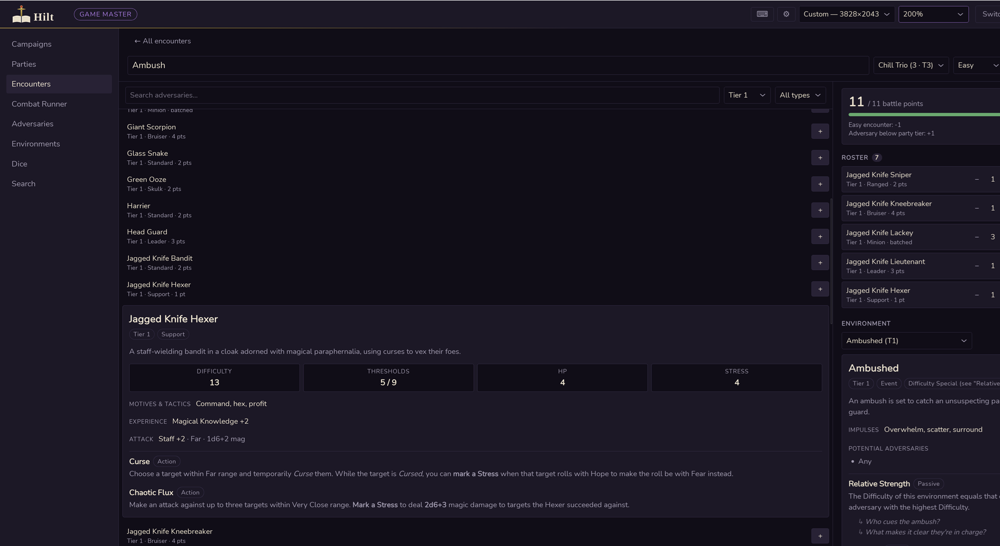
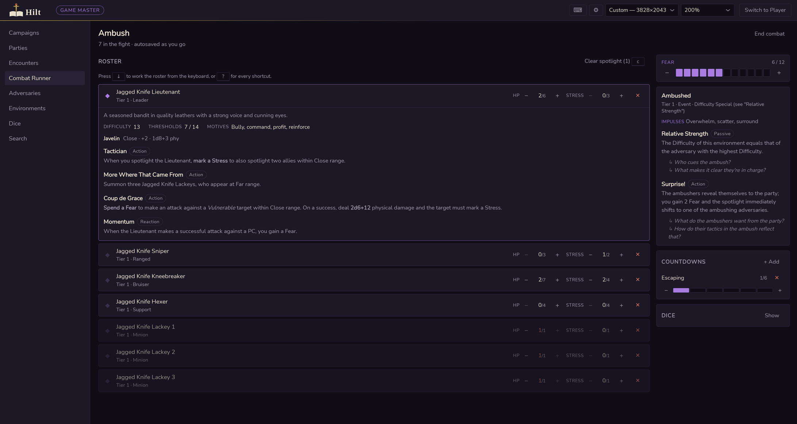
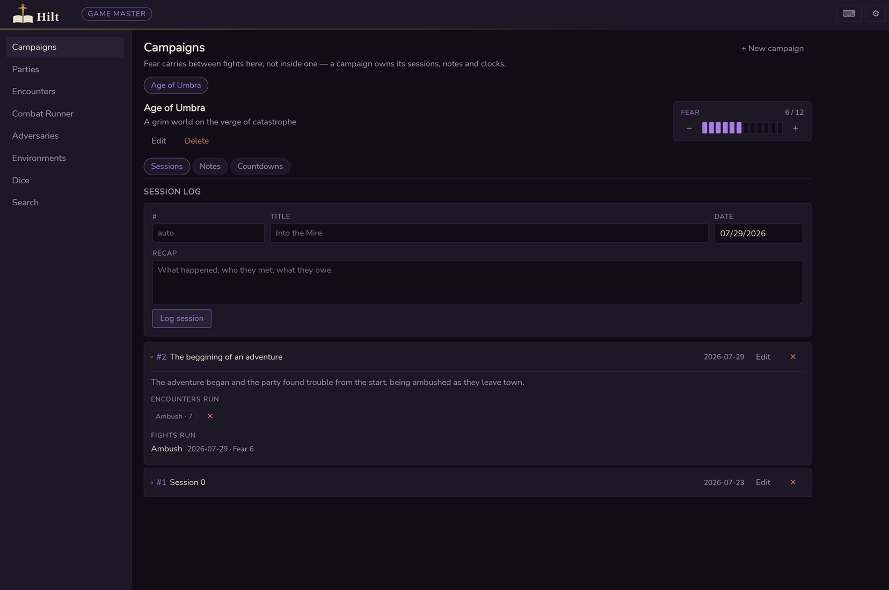
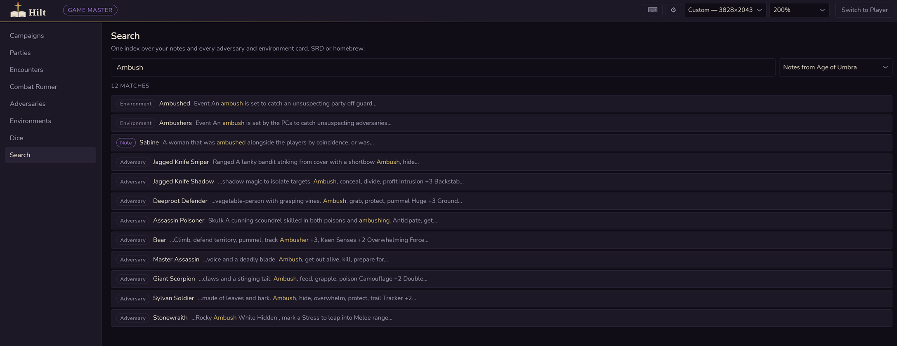
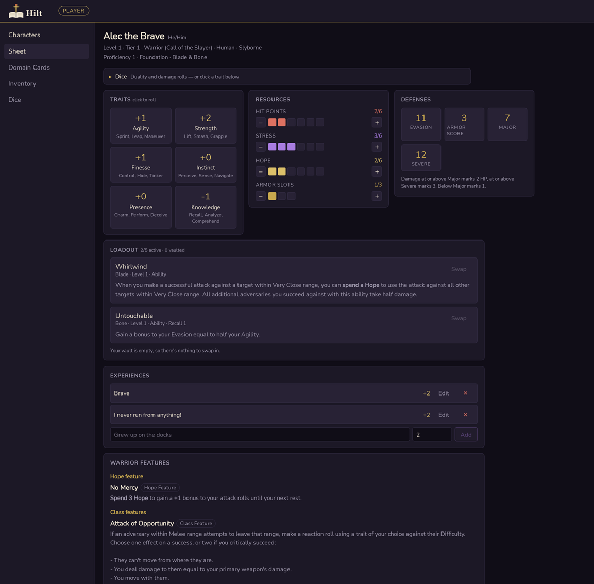
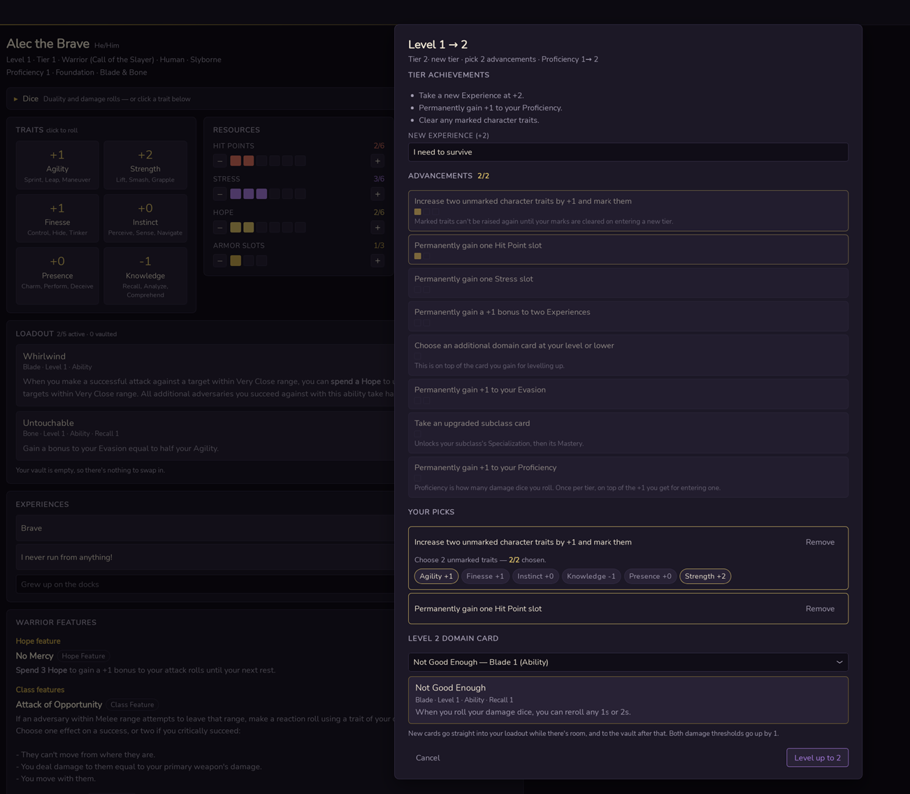

[](https://github.com/mhetem/DH-Companion/actions/workflows/ci.yml)

A **[Daggerheart](https://www.daggerheart.com/)™ Compatible** desktop companion for both
sides of the table.

**As a GM:** build encounters against a live battle-point budget, run the fight with
per-adversary HP, Stress and Fear tracking, and keep the campaign between sessions —
session logs, typed notes, countdown clocks, and full-text search across all of it.

**As a player:** a complete character sheet — the seven-step build wizard, live Hit
Points/Stress/Hope, your domain cards with their full text, the tier advancement table, and
duality dice that write their own Hope and Stress back to your sheet.

Local-first: everything lives in one SQLite file on your machine. No account, no server, no
network access unless you explicitly press "check for updates".

**Contents** — [Screenshots](#screenshots) · [Features](#features) · [Install](#install) ·
[Usage](#usage) · [Shortcuts](#keyboard-shortcuts) · [Architecture](#architecture) ·
[Data](#data) · [Status](#status) · [Contributing](#contributing) · [License](#license)

## Screenshots

|  |  |
|---|---|
| <br>**Encounter builder** — the budget meter recomputes on every edit against your party's size and tier. | <br>**Combat runner** — per-combatant HP and Stress, spotlight, the Fear pool and countdown clocks. |
| <br>**Campaigns** — Fear between fights, a numbered session log, and typed NPC/location/plot notes. | <br>**Search** — one FTS5 index over notes, adversaries and environments, with highlighted excerpts. |
| <br>**The sheet** — traits you can click to roll, live resource tracks, and your loadout in full. | <br>**Levelling** — the advancement table as its printed slot boxes, with each domain card's text before you commit. |

## Motivation

Running *Daggerheart* means holding a lot of state at once. Prep is a battle-point budget
weighed against your party's size and tier. The fight itself is HP and Stress on a dozen
adversaries, a Fear pool, and a couple of countdown clocks. Between sessions it's who the
party met, what they owe, and which thread is about to come due.

That usually ends up spread across a spreadsheet, a notes app, and a stack of index cards,
none of which know about each other. Hilt is one tool where the encounter you built is the
fight you run, the fight you run is logged to the session you played, and the NPC you wrote
up three weeks ago is one search away while you're running it.

It's a desktop app because the live combat runner wants to be there when the Wi-Fi isn't,
and because your campaign notes should be a file you own rather than a row in someone's
database.

## Features

### GM

- **Adversary and environment browsers** over the SRD catalog (264 adversaries, 47
  environments) merged with your own homebrew, filterable by tier and type. A custom card
  shadows an SRD one on slug collision.
- **Equipment browser** — every weapon and armor in the SRD (315 weapons across the primary,
  secondary and combat wheelchair tables; 69 armors), filterable by tier, primary/secondary
  and physical/magic.
- **Loot browser** — the item and consumable tables from both the Core Set and the Hope &
  Fear expansion (120 items, 120 consumables), filterable by rarity and source.
- **Loot randomizer** in both sections, because tier and rarity are different axes in the
  SRD: weapons and armor are drawn from a tier's tables, while items and consumables have no
  tier at all and are rolled on d12s — the rarity picks how many. Ask for any mix of the four
  and it rolls them in one go, showing the dice and the total beside each entry so you can
  read the result back to the printed table. If your table would rather throw real d12s,
  **Rolled at the table?** takes the total they got and resolves it against the right table
  instead — hand-entered results stack up in the same list, tagged *Entered*.
- **Homebrew editors** for custom adversaries, environments, weapons, armor, items and
  consumables, each with a live preview. The adversary and environment editors also have a
  reference pane that is the real browser — so you can crib from an existing card while you
  write, or copy one wholesale with *Use as template*.
- **Colossal adversaries** — the SRD's colossus, built as homebrew: a framework card with the
  thresholds, Stress and colossus-wide features, and a list of segments (head, torso, two
  arms…), each with its own Difficulty, HP, adjacent segments, attack and features. In the
  builder a colossus spends the whole budget on its own; in the runner it spawns as one row
  for its shared Stress with every segment's HP and Broken toggle grouped beneath it, and
  reads *Defeated* once every segment is Destroyed.
- **Parties** — size and tier, which is what the budget is computed from.
- **Encounter builder** with a live difficulty-budget meter: cost per adversary type,
  party-sized minion batching, a colossus taking the whole budget, and the easy/hard,
  multi-solo, below-tier and no-big-adversary adjustments. Attach an optional environment and see its impulses and
  features inline.
- **Combat runner** — start a fight from a saved encounter and its adversaries spawn as
  combatants with their own HP and Stress. Per-combatant steppers, non-exclusive spotlight,
  card quick-view, a 0–12 Fear tracker, countdown clocks, the environment on hand as GM
  prompts, and the dice rollers in the rail. State autosaves as you go, so closing the app
  mid-fight is safe.
- **Campaigns** — the connective tissue. A campaign owns its Fear, its **master note**, its
  numbered session log (with recaps and the encounters prepped for and actually run that
  night), its typed notes (NPC / location / faction / lore / plot, markdown body), its
  worldbuilding pages, its countdown clocks, and the maps and scenes for the player window.
- **The master note** — one free-form markdown page per campaign for the running timeline,
  saved as you type. It's the campaign's landing tab, and it sits in the combat runner's rail
  too, still editable, so the timeline is on hand mid-fight.
- **Worldbuilding** — the campaign's world as a tree of nested pages: regions holding cities
  holding places, and timelines whose events are laid out in order with their in-world
  dates. Each page is markdown, saved as you type; pages can be filtered, reordered, and
  moved anywhere in the tree, and deleting one takes everything inside it along.
- **Player window** — a second window for the screen the players can see, opened fullscreen
  on the other monitor. Each campaign keeps its own **maps** (shown whole, letterboxed),
  **scenes** (filling the screen) and **text** (markdown, over an optional backdrop), as
  images or looping video, so animated maps work too. Press **Show** and it crossfades in;
  **Blank** takes the screen to black. Nothing you browse, edit or prepare reaches the
  players until you press Show. **Turn, zoom and drag** what's showing from the GM's preview
  or on the player window itself — each map remembers how it was framed.
- **Full-text search** over notes, master notes, world pages, adversaries and environments
  in one SQLite FTS5 index, with highlighted excerpts. Equipment and loot are deliberately
  left out: six hundred-odd gear rows would bury the handful of hits you actually search for.
- **Dice** — a GM d20 with advantage/disadvantage and modifiers, plus a damage roller.
  Duality dice are deliberately absent: only players roll Hope and Fear.

### Player

- **Character creation** — a seven-step wizard through class, subclass, ancestry, community
  and traits, over the full SRD catalog (13 classes and their subclasses — the Assassin,
  Brawler, Warlock and Witch included — 25 ancestries, 15 communities), with the text for
  every option shown beside the picker.
- **The sheet** — traits, live-tracked Hit Points, Stress, Hope and armor slots, Evasion and
  both damage thresholds, gold in handfuls/bags/chests, and your class, subclass, ancestry
  and community features on the page.
- **Your loadout, in full, on the sheet** — the five cards whose effects you can actually
  use, with their complete text, right where you're playing from.
- **Loadout and vault** — you know two domain cards at level 1 and one more per level; five
  of them can sit in your loadout at a time, the rest in the vault (210 cards across ten
  domains, Dread included). The pool only ever offers cards in your domains at or below your
  level.
- **Recall Cost is enforced.** Swapping a card in from your vault mid-session marks Stress
  equal to its Recall Cost — and that cost is waived on a rest, so the short/long rest dialog
  offers the same swap for free. The app tells you the price before you pay it, and refuses
  the swap with the arithmetic spelled out if you can't.
- **Inventory** — gear and consumables, with one primary weapon, one secondary and one set of
  armor equipped at a time, plus a one-press way to add your class's starting items. Pick
  gear from the SRD tables as you type its name — every weapon, armor, item and consumable —
  or keep anything else as free text. **Equipping SRD armor sets your Armor Score and both
  thresholds**, and gear features like a shield's *+1 to Armor Score*, heavy armor's
  *−1 to Evasion* or Mage Robes' Spellcast trait to thresholds are applied while it's on; a
  two-handed weapon takes both hands.
- **Abilities count themselves in** — subclass features like the Stalwart's *Unwavering*,
  the Galapa's *Shell*, and loadout cards like *Fortified Armor* or *Untouchable* adjust
  Evasion, Armor Score, thresholds and slots as you level, equip and swap cards, and the
  Defenses card lists what it counted. Situational ones stay yours to apply.
- **Taking damage** — type the damage you took and the sheet marks the right number of Hit
  Points off your thresholds, optionally through an Armor Slot, and tells you when it's your
  last.
- **Levelling** — the tier advancement table with its slot boxes, remembering what you spent
  at earlier levels in the same tier, and applying the tier achievements at 2, 5 and 8.
  Every advancement that needs a follow-up choice grows it inline, a disabled *Level up*
  button says what's still missing, and **each domain card's full text renders under the
  picker** so you're not choosing off a list of names.
- **Proficiency** rises by +1 on entering a tier, and can be raised once more per tier by
  spending an advancement on it — capped at 6, with the option greyed out and the reason
  given once you're there.
- **Duality dice** — 2d12 read as Hope and Fear with your trait and Experience modifiers.
  A roll with Hope grants you a Hope and a critical also clears a Stress, written to your
  sheet as part of the roll. Damage rolls use your Proficiency as the dice count, and each
  equipped SRD weapon gets **Attack** (its trait) and **Damage** (its die and modifier)
  buttons. The roller sits in a collapsible block on the sheet as well as in its own section,
  and **clicking any trait rolls it**.
- **Rests** — choose your downtime moves (two on a short rest, three on a long one) rather
  than clearing everything by default, and each one reports the roll behind it.
- **Beastform** for druids — every form at your tier or lower with its trait and Evasion
  bonuses, attack and features. Transforming marks a Stress and shows your effective Evasion
  while you're in it.
- **Transformations** — Demigod, Ghost, Reanimated, Shapeshifter, Vampire and Werewolf, taken
  on the sheet when the GM grants one, with their features and questions beside your
  ancestry and community.
- **Martial Stances** for Martial Artist brawlers — mark the stances you know (within your
  allowance and tier), shift into one by spending a Focus, and the sheet drops you out on
  Severe damage. Focus is a track with a *Refocus* roll beside it.
- **Class trackers** — a warlock's Favor (with *Favor instead of Hope* after a roll and *Show
  Tribute* on a rest), a brawler's Combo Die (raised as a level-up advancement, rolled as a
  combo strike), and Brawler's Strike in the dice panel while barehanded.
- **What's true right now** — Eldritch Flesh, Conjure Shield, your stance, your Beastform, and
  toggles for timed effects like Patron's Mantle, Rogue's Dodge, Channeling or Frenzy adjust
  the Evasion and thresholds a hit is judged against, without touching your base numbers, and
  end themselves on the hit or rest that ends them.
- **Companion sheet** for Beastbound rangers — name, Evasion, attack, damage die and range,
  a Stress track, Companion Experiences, and the level-up options as a checklist. Damage
  rolls use your Proficiency and their die.
- **Gold** lives on the Inventory page, counted in handfuls, bags and chests.

### Both

- **Role is a view, not a login.** Switch GM ↔ Player at any time from the header. Nothing
  is locked to a role, and data built in either survives the switch and relaunch.
- **Keyboard-driven combat** — see [Keyboard shortcuts](#keyboard-shortcuts).
- **Backup and restore**, whole-library JSON export/import, and paste-able
  [share codes](#share-codes) for homebrew cards.
- **Window size and UI scale** are separate, remembered settings (80–200% scale, HD → 4K).
- **Updates itself** when you ask it to — see [Upgrading](#upgrading).

## Install

Grab the latest build from **[Releases](https://github.com/mhetem/DH-Companion/releases/latest)**
— no toolchain, no terminal.

| Platform | Download | How |
|---|---|---|
| **Windows** | `Hilt-…-windows-amd64-setup.exe` | Run the installer — it installs for your user only, with no admin prompt. Pick a Start-menu shortcut, a desktop shortcut, both, or neither. |
| **macOS** | `Hilt-…-macos-universal.dmg` | Open it and drag Hilt to Applications. Universal — Intel and Apple Silicon, macOS 12 or later. |
| **Linux** (Debian/Ubuntu) | `Hilt-…-amd64.deb` | `sudo apt install ./Hilt-*.deb`, then launch it from your app menu. |
| **Linux** (any distro) | `Hilt-…-x86_64.AppImage` | `chmod +x Hilt-*.AppImage && ./Hilt-*.AppImage` — nothing to install. |

Plain `.zip` / `.tar.gz` archives of the bare binary are attached too.

### First launch

The builds are **unsigned**, so each OS will object once:

- **macOS** — right-click the app and choose *Open* (not double-click), or
  `xattr -dr com.apple.quarantine /Applications/Hilt.app`
- **Windows** — SmartScreen: *More info* → *Run anyway*
- **Linux** — both packages need GTK 4.14+ (`libgtk-4-1`) and WebKitGTK 6.0
  (`libwebkitgtk-6.0-4`) present, which means Ubuntu 24.04, Debian 13 or newer; the `.deb`
  declares them, the AppImage assumes them. Animated maps in the player window play through
  GStreamer, so WebM needs `gstreamer1.0-plugins-good` and MP4 needs `gstreamer1.0-libav` —
  the `.deb` recommends both

Then pick a side of the table. The app creates its database at `~/DH-Companion/data.db`,
runs its migrations, and you're in.

### Upgrading

**Settings & data → Check for updates.** When there's a newer release, *Update* downloads
it, checks its signature against the key built into the copy you're running, and restarts
into it. Everything is saved as you go, so restarting mid-session loses nothing. That works
for the Windows installer and portable `.zip`, the macOS app and the AppImage. The `.deb`
and the `.tar.gz` update the way you installed them — Settings links to the download page
instead.

Earlier Windows releases installed for all users, in Program Files, where the app can't
replace itself. The current installer says so if it finds one; remove the old copy from
*Settings › Apps* afterwards.

Your data is untouched by any upgrade. **Uninstalling keeps it too** — the Windows
uninstaller has a *Campaigns, encounters and homebrew* tick-box that deletes
`%USERPROFILE%\DH-Companion` if you want a clean sweep, and it is unticked unless you ask.
Removing the `.deb` or deleting the AppImage never touches your data. There's a backup
button in **Settings & data** regardless.

> If you moved the database with `DH_DATA_DIR`, the uninstaller doesn't know about it —
> delete that folder yourself.

## Building from source

Requires [Go 1.26+](https://go.dev/dl/), [Node 22+](https://nodejs.org/), and the
[Wails v3 CLI](https://wails.io/). On Linux, also the GTK4 and WebKitGTK 6.0 headers
(`sudo apt install libgtk-4-dev libwebkitgtk-6.0-dev` on Ubuntu 24.04+).

```bash
go install github.com/wailsapp/wails/v3/cmd/wails3@v3.0.0
git clone https://github.com/mhetem/DH-Companion.git
cd DH-Companion
wails3 dev
```

A production binary is three steps — bindings, frontend, then Go:

```bash
wails3 generate bindings -i -clean=true
npm --prefix frontend ci && npm --prefix frontend run build
go build -tags production -trimpath -ldflags "-w -s" -o build/bin/DH-Companion
build/linux/package.sh v1.0.0 dist      # Linux -> dist/*.deb and dist/*.AppImage
```

The Windows installer and the macOS bundle are built in
[`release.yml`](.github/workflows/release.yml); its *Build* step is the recipe to follow
locally.

## Usage

**Pick a side of the table** first — Game Master or Player. Every launch asks, and the
header switches at any time without touching your data.

### As a GM

1. **Create a party** (Parties) — size and tier. Nothing in the budget meter means anything
   until one exists.
2. **Browse adversaries and environments**, and write your own homebrew from the same
   browsers.
3. **Build an encounter** (Encounters): pick a party, add adversaries and quantities, and
   watch the budget meter tell you whether the fight is under, at, or over. Optionally
   attach an environment.
4. **Create a campaign** (Campaigns) and log sessions against it. Fear lives here between
   fights.
5. **Run the fight** (Combat Runner): start from a saved encounter, pick the campaign whose
   Fear pool it spends, then mark damage and Stress, hold the spotlight, spend Fear, and
   advance clocks. Reopen exactly where you left off.
6. **Write it up.** Log the session with a recap, link the encounters you ran, and keep
   typed notes on the NPCs and places the party met. Build out the world they're travelling
   through under Worldbuilding. Search finds all of it later.
7. **Hand out loot.** Browse Equipment and Loot for anything in the SRD, or roll a haul:
   pick the party's tier for gear, the rarity for items and consumables, how many of each,
   and *Roll*. Tick **Include homebrew** to put your own gear in the mix — it's off by
   default so a haul is reproducible from the SRD alone. If the players rolled their own
   d12s, type the total into **Rolled at the table?** instead and it resolves that row;
   pick the kind and the book first, since the same total names a different entry in each.
8. **Put it on the table** (Player window). Add the campaign's maps, scenes and text — files
   are copied into the media folder, so the originals can move — then open the player window
   on the table's screen and press **Show** on whatever the players should see.

### As a player

1. **Build a character** (Characters) — the wizard walks class → subclass → ancestry →
   community → traits → defenses, showing the SRD text for whatever you're choosing next.
   Armor Score and both damage thresholds are asked for outright and it says where to read
   them off your armor — the armor dataset exists now, but only the GM's browser reads it;
   the sheet is not yet wired to it.
2. **Take your first two domain cards** (Domain Cards). The pool only offers cards in your
   domains at your level or lower.
3. **Play from the sheet.** Click any trait to roll it — a roll with Hope grants you a Hope,
   a critical also clears a Stress, and both are written to your sheet as part of the roll.
   Mark Hit Points, Stress, Hope and armor slots on the tracks. Your loadout is on the page
   with each card's full text.
4. **Swap cards as the scene demands.** From the sheet it marks Stress equal to the incoming
   card's Recall Cost; on a rest it's free.
5. **Rest** — choose your downtime moves (two on a short rest, three on a long one) rather
   than clearing everything by default. Each reports the roll behind it.
6. **Level up.** Pick two advancements against the tier's slot boxes and a new domain card,
   reading what each one does before you commit.

## Keyboard shortcuts

Press <kbd>?</kbd> anywhere for the full list. Shortcuts stand down while you are typing in
a field, and while a dialog is open.

### Combat runner

| Key | Action |
|---|---|
| <kbd>↑</kbd> <kbd>↓</kbd> / <kbd>k</kbd> <kbd>j</kbd> | Move the selection through the roster |
| <kbd>h</kbd> / <kbd>H</kbd> | Mark / clear 1 HP on the selected combatant |
| <kbd>s</kbd> / <kbd>S</kbd> | Mark / clear 1 Stress — on a colossus segment, the colossus's |
| <kbd>b</kbd> | Break / mend the selected colossus segment |
| <kbd>x</kbd> | Toggle spotlight |
| <kbd>c</kbd> | Clear every spotlight |
| <kbd>f</kbd> / <kbd>F</kbd> | Gain / spend a Fear |
| <kbd>Esc</kbd> | Drop the selection |

### Dice

| Key | Action |
|---|---|
| <kbd>r</kbd> | Roll the d20 |
| <kbd>d</kbd> | Roll damage |
| <kbd>a</kbd> / <kbd>z</kbd> | Toggle advantage / disadvantage |
| <kbd>1</kbd>…<kbd>7</kbd> | Pick the damage die, smallest to largest |
| <kbd>Esc</kbd> | Dismiss the result flash |

Selection is the keyboard's cursor over the roster and is deliberately *not* spotlight —
spotlight is a rules state you set on purpose and can hold on several combatants at once.

### Player window

These work on the player window itself, so they aren't on the <kbd>?</kbd> sheet.

| Key | Action |
|---|---|
| <kbd>F11</kbd> / double-click | Toggle fullscreen |
| <kbd>Esc</kbd> | Leave fullscreen |
| <kbd>r</kbd> / <kbd>R</kbd> | Turn what's showing right / left |
| <kbd>+</kbd> / <kbd>−</kbd> | Zoom in / out — the mouse wheel zooms at the cursor |
| <kbd>0</kbd> | Reset the framing |
| Drag | Move what's showing |

## Tech stack

- **Go 1.26** with **[Wails v3](https://wails.io/)** — native desktop shell, the system
  webview (WebKit on macOS and Linux, WebView2 on Windows), no Electron.
- **Svelte 5** (runes) + **Vite** for the frontend, built into the binary via `//go:embed`.
- **SQLite** through **[modernc.org/sqlite](https://gitlab.com/cznic/sqlite)** — pure Go, so
  the build needs no CGO and cross-compiles cleanly.
- **[sqlc](https://sqlc.dev/)** generates type-safe Go from hand-written SQL.
- **[goose](https://github.com/pressly/goose)** for migrations, embedded and run at startup.
- **SQLite FTS5** for search.
- No frontend dependencies beyond Svelte itself — the markdown renderer is ~90 lines in the
  repo rather than a package.

## Architecture

### The bridge

Wails registers Go structs as services and generates a JavaScript module for each one.
Each module is its own service rather than piling every method onto one object:

```
main.App         window size, UI scale, backup/restore, library, updates, the player window
gm.Service       everything GM — cards, parties, encounters, combat, campaigns
player.Service   everything Player — characters, sheet, loadout, levelling, rests
dice.Roller      the pure roll functions
```

The two service structs never call each other. GM and Player are **separate schema islands
in one database** — no shared records, no foreign keys across the line — so a change on one
side can't break the other.

Wails publishes *every* exported method on a service, which shapes the code: `gm.Attach`
is a package function rather than a method, because an `Attach` method would push
`context.Context`, `*db.Queries` and `*sql.DB` into the generated bindings.

### Data flow

```
Svelte component
  -> frontend/src/lib/{gm,player}/api.js   single import surface over the generated bindings
    -> frontend/bindings/…                 generated wrappers (wails3 generate bindings -i)
      -> internal/{gm,player}.Service      validation, bridge types, transactions
        -> internal/db (sqlc)              type-safe queries
          -> SQLite
```

Two rules hold throughout:

- **Nothing returns a `db.*` row.** The bridge types are `gm.Party`, `cards.Adversary`,
  `rules.EncounterView`, `gm.CombatView`, `player.Sheet` and so on, with `*T` for nullable
  columns — the frontend never sees a `sql.NullString`, and JSON-in-TEXT columns arrive
  decoded.
- **Mutators return the updated row.** There is no separate save step to fall out of sync
  with; the UI renders what the database actually holds. That is also the autosave: closing
  the app mid-fight or mid-session loses nothing, because there was never unsaved state.

### Project layout

```
main.go                 Wails entry, services
app.go                  App service: startup, the main window, window size, UI scale,
                        DB open + migrations
portable.go             backup/restore, library export/import, update check (file dialogs)
selfupdate.go           in-app update: the signed manifest, where it can install, restart
table.go                the player window: opening it, what it shows, serving /media/

internal/
  rules/                encounter budget math, loot rarity bands, the encounter view model
  dice/                 duality dice, GM d20, damage; die sizes as a closed set
  cards/                shared card model (adversary, environment, domain, class, …)
  srd/                  loader for the embedded SRD json
  db/                   sqlc-generated queries and models
  gm/                   the GM service — one file per area, plus:
    browse.go             SRD ∪ custom union, custom-shadows-SRD
    equipment.go          weapon and armor browse + homebrew CRUD
    loot.go               item and consumable browse + homebrew CRUD + the randomizer
    search.go             FTS5 query (hand-written; see Key decisions)
    library.go            whole-library JSON export/import
    share.go              homebrew share codes
    handouts.go           the player window's maps, scenes and text, and their media files
    validate.go           tier/type/kind lists, name and slug rules
  player/               the Player service — one file per area:
    characters.go         CRUD, the sheet view model, vitals and gold
    domaincards.go        loadout/vault, Recall Cost swaps
    leveling.go           the advancement plan and its application
    rest.go               downtime moves, short and long
    roll.go               duality and damage rolls that write back
    equipment.go          SRD gear, defenses kept in step with it, weapon damage
    abilities.go          ability and scaled armor bonuses, Bare Bones, and what the wizard adds
    effects.go            what's true right now: stress-, hope- and stance-driven bonuses, toggles
    classfeatures.go      Favor, Focus, stances, combo strikes, Brawler's Strike
    damage.go             taking damage against the thresholds
    beastform.go          druid forms
    companion.go          the Beastbound ranger's companion
  share/                the versioned share-code codec
  update/               GitHub release feed check

sql/
  schema/               goose migrations (34, embedded)
  queries/              sqlc sources

data/                   SRD json + //go:embed
build/                  appicon.svg and the rasterized platform icons
.github/workflows/      ci.yml, release.yml

frontend/src/
  App.svelte            role gate, error toast, reload key
  lib/
    Header.svelte         lockup, role badge, window/scale, settings, shortcuts
    Shell.svelte          nav + pane switching
    Modal.svelte          the scrim/sheet dialog shell (owns focus + Escape)
    Settings.svelte       backup, library, version, data location
    ShortcutHelp.svelte   the ? sheet
    EmptyState.svelte     full-pane "nothing here yet"
    SrdText.svelte        the one place SRD prose is rendered as HTML
    keys.js               keyboard mechanism (see Key decisions)
    gm/                   every GM pane; api.js is the single import surface
    player/               every Player pane; same api.js convention
    table/                the player window, mounted instead of App at /?table
```

Several components take a `compact` prop and are reused rather than duplicated — the dice
panel appears in its own section and in the combat runner's rail, the note list appears in
Campaigns and in the runner, the card browser is also the homebrew editor's reference pane,
and the loadout list is on the character sheet and inside the rest dialog.

## Key decisions

- **Role is a view, not a gate.** Both schema islands exist regardless of the current role,
  and switching touches no data. There is no auth anywhere in the app. The role isn't even
  remembered: two people sharing a machine, or one person who GMs one night and plays the
  next, get the choice put in front of them rather than landing in whichever shell was
  closed last.
- **sqlc, not an ORM.** Queries live in `sql/queries` as SQL and compile to type-safe Go.
- **Clamping happens in SQL.** Fear, HP, Stress and countdown values are written as
  `max(0, min(ceiling, current + delta))`, so holding a stepper at either end is a no-op
  rather than an error to handle mid-scene. `CHECK` constraints are the backstop.
- **Custom cards are addressed by slug, and slugs are immutable.** Slugs derive from the
  name on create; editing a card keeps its slug, so a rename can't orphan an encounter that
  references it. Deleting leaves referencing encounters intact — the pick comes back
  `unresolved` rather than failing the load.
- **The FTS5 read is hand-written Go, not sqlc.** sqlc 1.31.1 rejects every spelling of the
  fts5 `MATCH` idiom because its SQLite parser has no notion of a virtual table's hidden
  name column. Only the index *writes* go through sqlc. See the Phase 4 notes in
  [BUILD_PLAN.md](BUILD_PLAN.md) for the full list of what was tried.
- **Search excerpts are escaped, then re-highlighted.** `snippet()` returns surrounding text
  exactly as indexed, and note bodies are indexed raw, so the renderer escapes everything and
  lets only the `<mark>` markers back through.
- **UI scale is separate from window size.** A 4K window on a 4K screen makes everything
  physically *smaller*, because CSS pixels don't grow with resolution. Scale is applied to
  the root font size, which works because every length in the app is in `rem`.
- **`appearance: none` on native controls.** WebKitGTK paints `select`, number spinners and
  checkboxes as system widgets and ignores `background-color`, so they rendered as bright
  controls carrying the app's light text. Reclaiming them means drawing the chevron and tick
  as data URIs — which is why those two restate palette colors as literals.
- **Only players roll duality dice.** The runner has no Hope/Fear widget and nothing bumps
  Fear automatically; the GM gains and spends it by hand. A roll with Fear grants the player
  nothing, either — the Fear pool is the GM's, and the app never reaches across the islands.
- **The rules table is data, not code.** `data/leveling.json` holds every advancement as
  `{slots, cost, effect}`, so correcting a slot count or adding an option is a one-line data
  change with no Go to touch. What the code enforces is the *structure* — two advancements a
  level, the caps, the tier achievements — not the numbers.
- **Rests apply the moves you picked, and nothing else.** An earlier pass cleared Hit Points
  and Stress automatically, which invented a rule the SRD doesn't have. A short rest spent on
  Repair Armor and Prepare leaves your Hit Points exactly where they were.
- **Managing your collection is free; recalling mid-session is not.** The Domain Cards page
  charges no Recall Cost — reorganising after a level-up isn't a recall — while swapping from
  the sheet marks the Stress, and a rest waives it. Both pages say which they are.
- **Updates are checked only when you ask.** A background check would quietly undo the "no
  server" promise. Installing one is still a click: the release carries a manifest signed
  with an Ed25519 key whose public half is compiled into the app, so a copy only accepts a
  build signed by the same key — the OS signing these builds still lack isn't what
  authenticates an update.

## Data

The database is created at `~/DH-Companion/data.db`. Override the location with
`DH_DATA_DIR`. Everything below is in **Settings & data** (the gear in the header).

| Variable | Used by | Description |
|---|---|---|
| `DH_DATA_DIR` | app | Directory holding `data.db`. Defaults to `~/DH-Companion`. |
| `GOOSE_DRIVER` | migrations | `sqlite3`, for running goose by hand. |
| `GOOSE_DBSTRING` | migrations | Path to the database file. |
| `GOOSE_MIGRATION_DIR` | migrations | `sql/schema`. |

### Backup and restore

A backup is a `VACUUM INTO` snapshot — a consistent copy of the live database taken without
closing it, which a plain file copy of a WAL-mode database is not. Restoring validates the
incoming file first (it must carry both `settings` and `goose_db_version`), snapshots your
current database to `data-replaced-<timestamp>.db`, then swaps and reopens.

The player window's images and videos are **not** in the backup. They're copied into
`media/` beside the database when you add them, named by their SHA-256 so the same file
added twice is stored once, and removed when the last map or scene using them goes. Copy
`media/` along with a backup to move everything to another machine; a map whose file didn't
come along says *File missing* until you choose it again.

### Library export/import

Readable JSON covering parties, homebrew cards (adversaries, environments, weapons, armor,
items and consumables), encounters, and campaigns with their sessions, notes, master note,
world pages and clocks — not the player window's maps, scenes and text, whose files don't
belong in JSON. Import **adds what's new and overwrites what matches**, and never
deletes — so exporting on one computer and importing on another keeps the two in step, and
importing the same file twice changes nothing. What counts as a match:

| Record | Matched by |
|---|---|
| Homebrew cards | slug (survives a rename), then name |
| Parties, encounters, campaigns | name |
| Sessions | number, within the campaign |
| Notes, countdowns | title / name, within the campaign |
| World pages | title, under the same parent page |

Names match ignoring case and surrounding spaces. Session links are only ever added, and a
blank master note never overwrites a written one. Imported encounters are remapped so their
picks still resolve. The equipment, loot and world arrays are additive, so an export from an
older build still imports and an older build ignores what it doesn't know. World pages
travel as a nested tree, in their sibling order.

### Share codes

Any homebrew card — adversary, environment, weapon, armor, item or consumable — has a
*Share* button producing a `HILT1:…` string;
*Import code* in the browser takes one back. The format is
`HILT<version>:<base64url(zlib(json))>` — versioned, so a code from a newer build is refused
with a message that says so rather than failing as corrupt. A code carries **one card and
nothing else**: no encounters, no campaign, nothing personal. Imports are previewed before
they are written.

## Running

```bash
wails3 dev     # Vite hot reload; rebuilds and regenerates the bindings on Go changes
go test ./...  # backend unit tests
```

`wails3 dev` runs the steps in [`build/config.yml`](build/config.yml) — there is no
Taskfile. For a production binary, see [Building from source](#building-from-source).

After changing anything in `sql/schema/` or `sql/queries/`, regenerate the DB layer:

```bash
sqlc generate
```

To run migrations by hand (the app runs them at startup anyway), source the `.env` in the
repo root and use `goose up`.

## Testing

```bash
go test ./... -race                                # everything, as CI runs it
go test ./internal/rules/... ./internal/dice/...   # the pure logic
cd frontend && npm run check                       # svelte-check: types across the bridge
```

Tests cover the encounter budget math, the dice rollers and die-size validation, the GM
service, the share-code codec, and the update check. There is no container dependency — the
service tests run against SQLite in place, which is the same engine as production, and the
update check runs against an `httptest` server rather than the network.

`npm run check` type-checks the Svelte and JS against the generated bindings, which is what
catches a frontend call that no longer matches its Go signature. It is not in CI yet.

## CI and releases

Two workflows:

- **`ci.yml`** — on every push and PR: `gofmt -l` (failing on any unformatted file),
  `go vet`, `go test ./... -race`, then a production build — bindings, frontend,
  `go build -tags production` — on Linux, Windows and macOS.
  `fail-fast: false`, so one platform breaking still reports the others.
- **`release.yml`** — on a `v*` tag: builds `linux/amd64`, `windows/amd64` and
  `darwin/universal`, packages each with `LICENSE`, `NOTICE.md` and `README.md`, signs the
  update `manifest.json` with the `UPDATER_KEY` secret (and checks it against
  `build/updater.pub` before going further), publishes `SHA256SUMS.txt`, and attaches
  everything to a GitHub Release. The tag is stamped into the binary via
  `-ldflags -X main.version=...`; untagged builds report `dev` and don't self-update.
  The release notes are the install and upgrade notes every release shares, with
  `docs/releases/<tag>.md` on top when the tag has one — write it before tagging.

Release binaries are **unsigned** — macOS Gatekeeper and Windows SmartScreen will both warn
on first run.

## Status

**1.0 — both sides of the table are complete.**

| Phase | | |
|---|---|---|
| 0 | Foundations — launches, opens its database, role picker | ✅ |
| 1 | Shared core — budget math, dice, card model, SRD loader | ✅ |
| 2 | GM: encounter builder, browsers, homebrew editors, budget meter | ✅ |
| 3 | GM: live combat runner, Fear, countdowns, autosave | ✅ |
| 4 | GM: campaigns, session log, typed notes, FTS5 search | ✅ |
| 5 | Player: character sheet, loadout/vault, levelling, duality dice | ✅ |
| 6 | CI, packaging, releases, data portability, share codes | ✅ |
| 7 | Post-1.0 roadmap — see below | ⬜ |

Phase 7 is the shortlist for the release *after* this one, and nothing in it is a
prerequisite for anything above. The weapon and armor datasets have since landed on the GM
side, so what remains of that item is wiring the player sheet to them, so equipping gear
sets your thresholds and damage die instead of you typing them in. The rest: a "took N
damage" box that marks the right number of Hit Points, death moves, code signing, and the
optional LAN session view — the GM's app broadcasting Fear, countdowns and spotlight to
read-only player devices on the same Wi-Fi.

[BUILD_PLAN.md](BUILD_PLAN.md) has the full roadmap and, per phase, a "notes on what
landed" section recording why things are the way they are — including the ones that were
wrong the first time.

## Contributing

Contributions are welcome. A rough workflow:

1. Fork the repository and create a feature branch.
2. `wails3 dev` and make your change.
3. If the change touches the database, add a goose migration under `sql/schema/` and the
   matching query in `sql/queries/`, then run `sqlc generate`.
4. Run `gofmt`, `go vet` and `go test ./... -race` — CI enforces all three. If you touched
   the frontend, `cd frontend && npm run check` too; it currently passes clean.
5. Record *why*, not just what, in the relevant phase's notes in `BUILD_PLAN.md`. That file
   is where this project keeps its rationale, which is why the Go and SQL are comment-free.
6. Open a pull request describing the change and how you verified it.

Please open an issue first for larger changes so the approach can be discussed.

## License

The **software** — Go, Svelte, CSS, SQL, build config, and the Hilt name and logo — is
[MIT](LICENSE).

The **game content in `data/`** is not. It comes from the Daggerheart System Reference
Document 2.0, © Critical Role, LLC, used under the
[Darrington Press Community Gaming License](https://darringtonpress.com/license/), and stays
the property of its owner. The required attribution, and what applies to you if you fork
this, are in [NOTICE.md](NOTICE.md).

Daggerheart™ is a trademark of Critical Role, LLC. This is an independent, unofficial tool,
not sponsored by or affiliated with Darrington Press or Critical Role.

